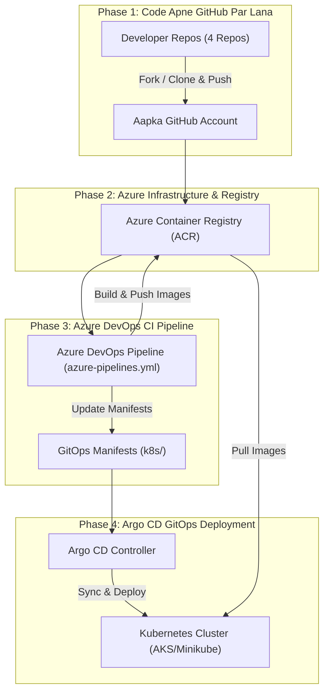

# 🚀 Complete DevOps Guide: Axion Microservices (GitHub ➡️ Azure DevOps ➡️ ACR ➡️ Argo CD)

Aapke screenshot ke mutabik developer ke paas yeh **4 public repositories** hain:
1. 🌐 **`axion-ui`** (TypeScript - Frontend Dashboard)
2. 🔄 **`axion-data-simulator`** (Python - Test Data Generator)
3. 🗄️ **`axion-database-schema`** (Database Schema / Migrations)
4. ⚙️ **`axion-ingestion-service`** (Python - Backend API & Data Ingestion)

---

## 🎯 Plan of Action (From A to Z)



---

## 📌 Phase 1: Developer ke 4 Repos ko Apne GitHub pe Kaise Dalein

Iske **2 simple tareeqe** hain:

### Method A: Forking (GitHub UI se - Sabse Fast, 1 Minute me)
Agar developer ka repository public hai (jaise screenshot me Public dikh raha hai):
1. Developer ke GitHub page par har repository ka URL kholein:
   - `https://github.com/<developer-username>/axion-ui`
   - `https://github.com/<developer-username>/axion-data-simulator`
   - `https://github.com/<developer-username>/axion-database-schema`
   - `https://github.com/<developer-username>/axion-ingestion-service`
2. Top right corner me **Fork** button (🍴) par click karein.
3. Apna GitHub account (Owner) select karein aur **Create fork** dabayein.
4. Chaaron repositories turant aapke GitHub profile par aa jayengi! 🎉

---

### Method B: Independent Repositories (Terminal / CLI se - No "forked" tag)
Agar aap chahte hain ki repo aapka apna independent repository bane (kisi ko pata na chale ki fork kiya hai):

#### Step 1: Apne GitHub par 4 empty repos banayein
1. [GitHub.com](https://github.com) -> Top right `+` -> **New repository**.
2. Naye repository banayein with same names:
   - `axion-ui`
   - `axion-data-simulator`
   - `axion-database-schema`
   - `axion-ingestion-service`
3. ⚠️ **"Add a README file" uncheck rakhein**. Completely blank repository create karein.

#### Step 2: Terminal (PowerShell) me yeh commands chalayein:
```powershell
# Ek folder banayein
cd "c:\Labs\Argo CD"
mkdir developer-repos
cd developer-repos

# 1. Axion UI ko copy karke apne GitHub par daalein
git clone https://github.com/<developer-username>/axion-ui.git
cd axion-ui
git remote remove origin
git remote add origin https://github.com/<your-username>/axion-ui.git
git branch -M main
git push -u origin main --all
cd ..

# 2. Axion Data Simulator ko copy karke apne GitHub par daalein
git clone https://github.com/<developer-username>/axion-data-simulator.git
cd axion-data-simulator
git remote remove origin
git remote add origin https://github.com/<your-username>/axion-data-simulator.git
git branch -M main
git push -u origin main --all
cd ..

# 3. Axion Database Schema ko copy karke apne GitHub par daalein
git clone https://github.com/<developer-username>/axion-database-schema.git
cd axion-database-schema
git remote remove origin
git remote add origin https://github.com/<your-username>/axion-database-schema.git
git branch -M main
git push -u origin main --all
cd ..

# 4. Axion Ingestion Service ko copy karke apne GitHub par daalein
git clone https://github.com/<developer-username>/axion-ingestion-service.git
cd axion-ingestion-service
git remote remove origin
git remote add origin https://github.com/<your-username>/axion-ingestion-service.git
git branch -M main
git push -u origin main --all
cd ..
```

---

### Method C: Monorepo Approach (DevOps Best Practice for 1 Pipeline)
Agar aap 4 alag-alag pipeline nahi banana chahte, balki ek single project repository me sab rakhna chahte hain:
Aapke `c:\Labs\Argo CD` folder me humne already:
```text
c:\Labs\Argo CD\
├── axion-ui/                 (Frontend)
├── axion-data-simulator/     (Simulator)
├── axion-database-schema/    (DB schema)
├── axion-ingestion-service/  (Backend)
├── k8s/                      (Kubernetes Manifests for all 4)
├── argocd-apps/              (Argo CD Application configs)
└── azure-pipelines.yml       (Single Pipeline that builds all 4)
```
Aap ek naya repo `axion-devops-project` banakar is poore folder ko direct push kar sakte hain:
```powershell
cd "c:\Labs\Argo CD"
git init
git branch -M main
git add .
git commit -m "feat: initial commit with axion microservices and k8s manifests"
git remote add origin https://github.com/<your-username>/axion-devops-project.git
git push -u origin main
```

---

## 📌 Phase 2: Azure Container Registry (ACR) Setup

Aapka Azure Container Registry jahan 4 images store hongi:
```bash
az login
az group create --name axion-rg --location eastus
az acr create --resource-group axion-rg --name mydemoregistry123 --sku Basic --admin-enabled true
```

Registry login server: `mydemoregistry123.azurecr.io`

---

## 📌 Phase 3: Azure DevOps (ADO) Pipeline Setup

### Step 3.1: Service Connection create karein
1. **Azure DevOps** -> Apna project open karein -> Left bottom me **Project Settings ⚙️**.
2. **Service connections** -> **New service connection**.
3. **Docker Registry** choose karein -> **Azure Container Registry**.
4. Apna Azure Subscription aur Registry select karein.
5. Connection Name: `acr-service-connection`.
6. **Grant access to all pipelines** tick karein -> **Save**.

### Step 3.2: Pipeline Run karein
1. **Pipelines** -> **New Pipeline** -> **GitHub (YAML)**.
2. Apna repository choose karein.
3. **Existing Azure Pipelines YAML file** -> `/azure-pipelines.yml`.
4. **Run** button dabayein.

Yeh pipeline:
- `axion-ui`, `axion-data-simulator`, `axion-ingestion-service`, `axion-database-schema` charo ke Docker images build karegi.
- `mydemoregistry123.azurecr.io/<app>:$(Build.BuildId)` tag ke sath ACR me push karegi.
- `k8s/` folder me deployment YAMLs me naye image tags update karke Git me auto-commit kar degi!

---

## 📌 Phase 4: Cluster & Argo CD Deployment

### Step 4.1: Cluster ko ACR access dein
```bash
# Agar AKS hai:
az aks update -n <aksCluster> -g axion-rg --attach-acr mydemoregistry123
```

### Step 4.2: Argo CD Install karein
```bash
kubectl create namespace argocd
kubectl apply -n argocd -f https://raw.githubusercontent.com/argoproj/argo-cd/stable/manifests/install.yaml
```

### Step 4.3: Argo CD Application Manifest Apply karein
[argocd-apps/all-apps.yaml](file:///c:/Labs/Argo%20CD/argocd-apps/all-apps.yaml) me apna GitHub URL update karein aur run karein:
```bash
kubectl apply -f argocd-apps/all-apps.yaml
```

Argo CD UI me chaaro applications:
- `axion-ui-app`
- `axion-data-simulator-app`
- `axion-ingestion-service-app`
- `axion-database-schema-app`

Green color me **Synced & Healthy** aa jayenge! 🚀
